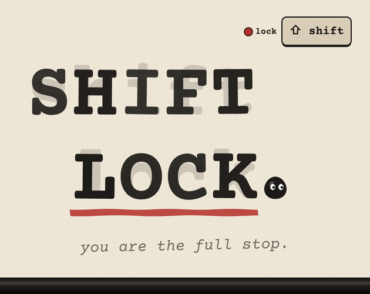
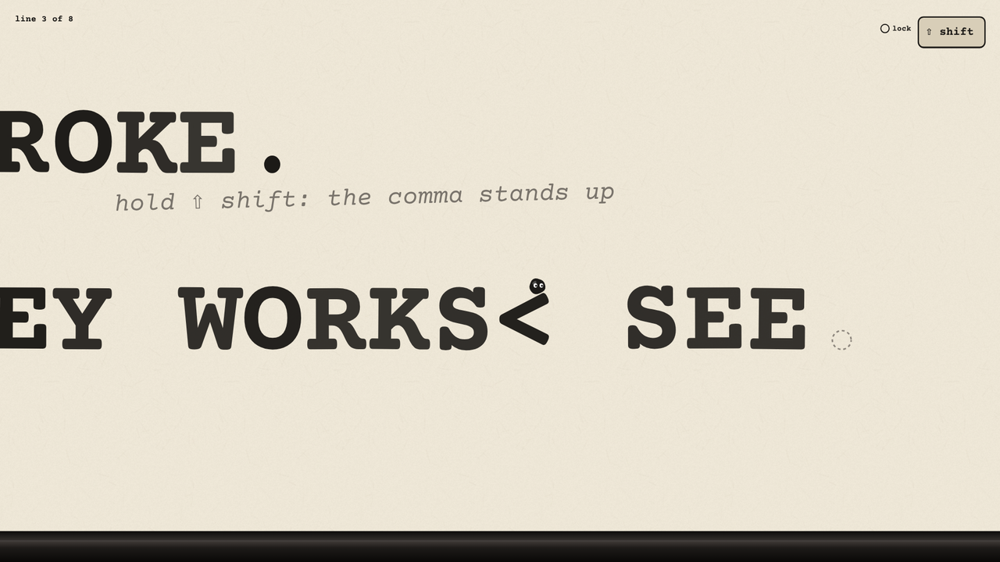
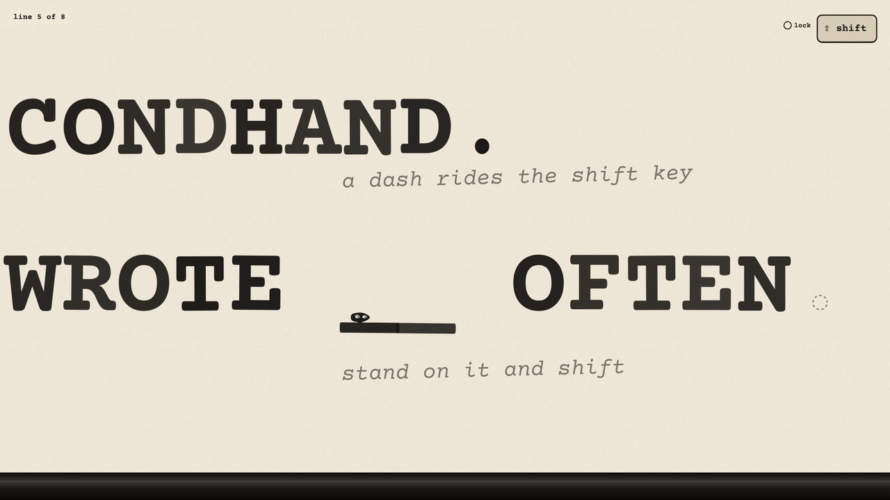
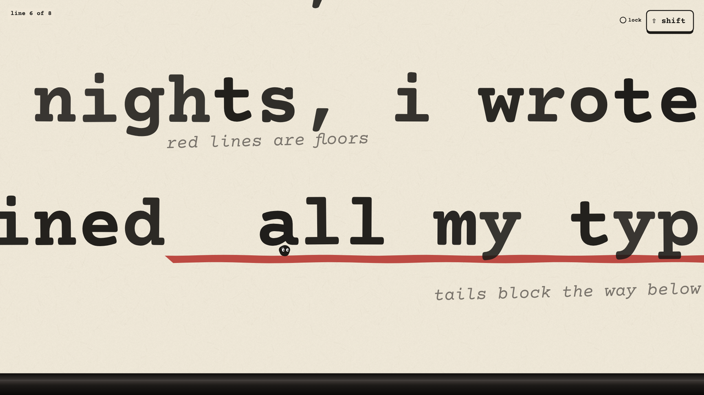
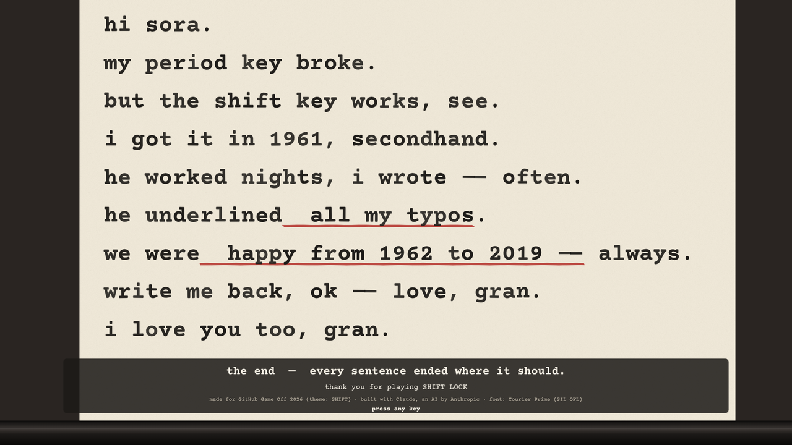

# SHIFT LOCK

**Gran's typewriter lost its period key. You are the full stop.**

A short typewriter platformer made for [GitHub Game Off 2026](https://itch.io/jam/game-off-2026) (theme: **SHIFT**).
Every level is one line of a letter from a grandmother to her grandchild. Walk across the typed words and land
where the sentence should end. Hold **Shift** and every key on the page swaps to its other face:
commas stand up into ramps, digits turn into spikes and hooks, dashes drop into underscores and carry you like a lift.
At the end you type the reply yourself, and the period key is still broken.

| | |
|---|---|
|  |  |
|  |  |

## Play

Open `index.html` in a browser (no build step, no libraries, no network calls), or play the HTML5 build on itch.io.
About 10 minutes. English and Japanese (press **J**). Keyboard, gamepad and touch.

| | keyboard | gamepad | touch |
|---|---|---|---|
| move | ← → or A D | stick / d-pad | ◀ ▶ |
| jump | Space, W, ↑ or Z | A / B | ⤒ |
| shift (hold) | Shift or X | shoulder buttons | ⇧ |
| shift lock | Caps Lock or L | Y | LOCK |
| type the line again | R | Back | menu |
| menu · sound · 日本語 | Esc · M · J | Start | II |

## How the page shifts

Each key has two faces, like the type bar of a real typewriter: `a`/`A`, `1`/`!`, `,`/`<`, `-`/`_`, `9`/`(` and so on
(a US layout). The level is the ink itself, so when the page shifts, the ground changes shape.

- **Commas** are a gap you cannot cross in lowercase; with shift they stand up as `<` ramps.
- **Digits** are flat in lowercase and spiky in shift, with tails that hang below the line.
- **Dashes** float above the baseline; shifted they become `_` floors below it. Stand on one and let go of shift: it lifts you.
- **Red underlines** are Grandpa's corrections. Red ink never shifts, so they are floors you can trust, under the line.
  Letters with tails (`g j p q y`, and `( ) $ @ [ ]` when shifted) block the way underneath.
- If shifting would crush you inside a letter, the key **jams**.
- Double spaces are Gran's typos, and you can fall through them.

Every line was checked with a search over the real physics (`tools/solve.html`): each one can be finished,
and the lines that teach a shift trick cannot be finished without it.

## Theme

SHIFT is the key you hold: one key press changes every letter on the page, and with it every floor, wall and slope.
It is also a shift in who is writing. You spend the game putting full stops on someone else's sentences;
in the last line you write back, and the ending is up to you.

## Made with AI

SHIFT LOCK was made with **Claude**, an AI model by Anthropic. Claude wrote the code, designed and tested the levels,
wrote the English and Japanese text, programmed the sound effects and music (synthesized live with the Web Audio API),
and wrote the scripts that draw the cover, the screenshots and the trailer.
No generative model runs while you play, and the game ships no AI-generated images or audio files:
everything on screen is drawn in code with the Courier Prime typeface.

## Files

- `index.html`, `css/`, `js/`, `fonts/`: the game (vanilla JavaScript, Canvas 2D, Web Audio).
  `js/engine.js` holds the layout and physics, `js/levels.js` the letter, `js/sound.js` the synthesizer, `js/main.js` the rest.
- `tools/`: the level solver, a tracer, a mask viewer and headless test scripts (Playwright).
- `trailer/`: records the trailer frame by frame in virtual time with scripted input and renders its soundtrack offline.

## Licenses

Code: MIT (see `LICENSE`). Font: Courier Prime, Copyright 2015 The Courier Prime Project Authors,
SIL Open Font License 1.1 (see `fonts/OFL.txt`).

---

### 日本語

おばあちゃんのタイプライターは、ピリオドのキーが折れてしまいました。きみが、そのピリオドです。
手紙の1行が1ステージ。文字の上を歩いて、文の終わりに着地します。シフトを押すと、紙の上の文字がぜんぶもう一方の姿に変わり、
カンマは坂に、数字はトゲに、ダッシュはアンダーバーになって足場が動きます。最後は、きみが返事を打つ番です。
制作には Anthropic の AI「Claude」を使用しました（コード、ステージ設計と検証、英日の文章、効果音と音楽の合成プログラム、カバー・スクリーンショット・紹介動画の生成スクリプト）。
